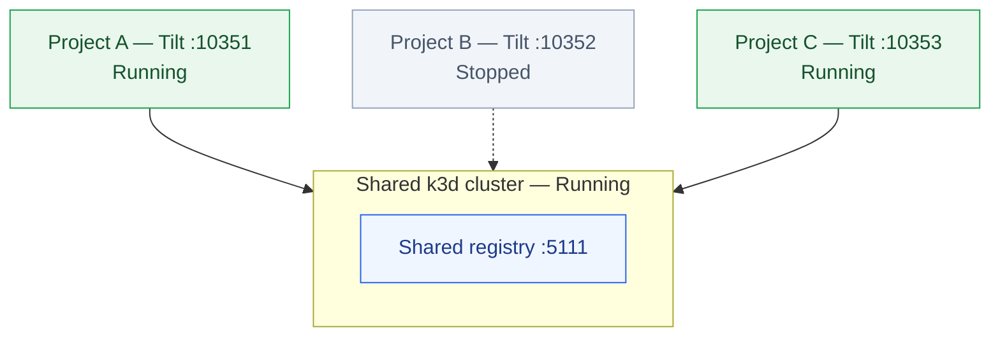

# Tilt Desktop

Tilt Desktop is a local Kubernetes development-environment manager built in Go. It is designed to manage k3d clusters and Tilt instances without requiring developers to provision local clusters manually.

## Architecture

- **Go core**: project definitions and lifecycle orchestration.
- **Fyne GUI**: native Go widgets; no React, TypeScript, Electron, or WebView.
- **Tiltfile**: the source of truth for build, deploy, and live-update behavior.
- **Cluster isolation**: dedicated k3d cluster per application by default, with explicit shared-cluster assignments.

### Shared cluster lifecycle



Illustrative local port assignments. Stopping project B leaves projects A and C running and preserves the shared cluster and registry. Each project has its own Tilt process; Kubernetes namespaces and resources remain the responsibility of the project's Tiltfile.

## Current implementation

- `internal/project`: validates application IDs, project directories, Tiltfiles, and dedicated/shared cluster assignments.
- `internal/desktop` and `cmd/tilt-desktop`: native Fyne application with a project catalog, folder picker, explicit start/stop/delete actions, resource and log views, safe-state handling and background lifecycle calls.
- The persistent catalog and kubeconfig files use POSIX file permissions on Linux/macOS and explicit user-restricted Windows ACLs. Process reconciliation uses OS-native read-only liveness checks.
- `internal/application`: persists a versioned project catalog under the user's config directory, derives a stable dedicated-cluster identity, and coordinates cluster creation/reuse, private kubeconfig materialization, Tilt startup, status, resources, logs, stop and confirmed deletion. New registrations do not require developers to pre-create a cluster or edit the Tiltfile.
- `internal/tilt`: starts and supervises independent Tilt processes for project/k3d-cluster pairs with explicit private kubeconfig and bound localhost port; reads UIResource snapshots and bounded log output using the Tilt CLI.
- Tilt child processes are stopped by interrupting the process, not by running `tilt down`. Unexpected process exits are exposed through session status.
- `internal/k3d`: discovers clusters, ensures a cluster is created or running, stops and deletes only clusters whose k3d runtime labels match the requested management ID, and reads their kubeconfig.
- A newly created cluster receives a dedicated registry bound to localhost. The application manager selects available local ports automatically; when a cluster already exists, it recovers the registry's published port from `k3d registry list --output json`. Persistent managers serialize startup and reject ports assigned to other catalog entries. This is not a socket reservation against external processes.
- The k3d CLI runs through Go's `os/exec`, without Bash scripts. Ownership is verified against actual Docker container labels because k3d's JSON cluster listing omits user-defined labels. `NewLocalClient` uses an isolated `KUBECONFIG` under the user's config directory; cluster creation disables k3d's default kubeconfig update.

**Real integration verification:** the `integration` GitHub Actions workflow runs a tagged Go integration test on Ubuntu with Docker, k3d, Tilt, and kubectl. It creates a managed cluster and localhost registry, builds and pushes an image through Tilt, verifies a Kubernetes Deployment rollout and API/log queries, then stops Tilt without deleting deployed resources, restarts the cluster, deletes it, and verifies the global kubeconfig was not modified.

**Persistence and reconciliation:** `NewLocalManager` loads `tilt-desktop/catalog.json` from the user's configuration directory. The version 2 catalog stores projects and clusters separately: each project references a cluster, registry ports belong to clusters, and Tilt ports belong to projects. Version 1 catalogs are validated and migrated atomically under the exclusive manager lock, preserving existing dedicated cluster identities and session metadata. Entries are written via an atomic same-directory replacement and stored with restrictive permissions; kubeconfig **contents** are never stored in the catalog. Tilt startup metadata (port, kubeconfig path and PID) is journaled. A new manager reuses the previously assigned Tilt HTTP port when it is free, and returns an explicit conflict if it is occupied. It can inspect an existing Tilt Session through its local API and compare the Tiltfile and PID. Verified but unmanaged live processes are reported as `orphaned`, and uncertain processes as `unknown`; both block duplicate starts and destructive operations. A previously owned process that is confirmed dead and whose port is free can be marked idle, and stale credentials removed.

**Limitations:** Tilt Desktop does **not** adopt or terminate orphaned processes from a previous application instance automatically. The persistent manager holds an exclusive OS file lock for its state directory, rejecting a second owner before reading the catalog. The lock is released by Close or process termination. Registry ports are unique across clusters and Tilt ports across projects; no Tilt port can overlap a registry port, including stopped assignments. Conflicts fail explicitly. Shared clusters can be registered through the Go API. Each member has an independent Tilt session, but shares the Kubernetes cluster and registry. Stopping or deleting a member does not stop or delete the shared cluster. Shared cluster stop requires every member to be reconciled idle; deletion requires zero members and explicit confirmation. Shared Kubernetes resources are not automatically namespaced or isolated by Tilt Desktop. Arbitrary external processes can still claim ports between availability probes and child binds; atomic host-port handoff is not implemented. The existing low-level APIs still accept explicit ports and kubeconfig paths. The catalog restores registered projects, not live process handles. Real Docker/k3d/Tilt integration on macOS and Windows remains pending. A successful `Start` indicates process launch, not workload readiness. Linux CI is validated; macOS and Windows operation, including graceful interrupts, remains unverified. The UI requires explicit confirmation before destructive deletion.

## Desktop application

Start the native UI from the repository root:

```sh
go run ./cmd/tilt-desktop
```

The desktop requires Docker, k3d and Tilt installed and available on `PATH` for cluster lifecycle actions. On Linux, compiling the native GUI also requires OpenGL and X11 development libraries. Kubernetes resources are built and deployed through the project's existing Tiltfile.

Use **Add project** to register a directory containing a Tiltfile, then choose a dedicated cluster (the default), an existing shared cluster, or a new shared cluster. A new shared cluster name must start with `td-shared-`; it is provisioned on the first member start. Select a project to inspect its state, cluster mode, resources and recent logs. **Start** creates or resumes its environment. **Stop** stops Tilt and the dedicated cluster in dedicated mode, or only Tilt in shared mode. **Delete** requires confirmation: dedicated mode destroys the dedicated cluster, while shared mode removes only the project registration. Neither deletes the source directory.

Use **Shared clusters** to inspect registry ports and project/session counts, stop a cluster with all sessions idle, or delete an unassigned cluster with explicit confirmation. Starting a member resumes the shared cluster.

Long-running operations execute off the GUI thread. **Refresh** reconciles the persisted catalog against observable Tilt sessions. Unverified, orphaned or starting sessions block destructive operations. Closing the window while managed sessions are running asks whether to stop them first; it does not run `tilt down`.

### Environment diagnostics

The **Environment** dialog reports the resolved executable paths and versions of Docker, k3d and Tilt, and checks whether Docker's daemon responds and supports Linux containers. It uses the same Go evaluator as the headless installation preflight.

For installation tooling, build or download the platform-specific `tilt-desktop-check` binary (`tilt-desktop-check.exe` on Windows). It is compiled without CGO and does not need Fyne, a display, or access to the project catalog:

```sh
CGO_ENABLED=0 go build -o tilt-desktop-check ./cmd/tilt-desktop-check
./tilt-desktop-check
```

The command emits a JSON report with `ready` and `checks`, including paths, versions and diagnostic errors. Exit status 0 means all probes passed, 1 means environment requirements are not satisfied, and 2 indicates command usage or output failure. Run the evaluator in the intended desktop user's environment, not an unrelated privileged installation context.

The persistent application manager re-evaluates the required dependencies before each external operation. Starting a project requires Docker, k3d, Tilt and a reachable Linux-container daemon. Dedicated project stop/deletion and explicit shared cluster stop/deletion require Docker and k3d plus the daemon. Reading Tilt resources or logs requires Tilt. Shared project stop/removal uses the owned process handle and does not require Docker; catalog registration, listing and local status remain available without external tools. Reconciliation preserves its conservative session-identity checks even when the Tilt API is unavailable. An unavailable required dependency blocks the corresponding operation before runtime mutation; results are not cached.

The future curl-based installation script and native installers must consume this same preflight rather than implementing independent dependency detection. A drag-and-drop DMG does not run installation hooks; it requires an explicit preflight launcher or first-launch check. No installer or public release is published yet. The evaluator does not install tools, change permissions or contexts, or guarantee version compatibility and successful cluster provisioning.

### Native build artifacts

The `Desktop packages` GitHub Actions workflow creates native test packages using the pinned Fyne CLI and the Go module lockfile:

| Target | CI artifact | Contents |
| --- | --- | --- |
| Linux x86-64 | `tilt-desktop-linux-amd64` | `TiltDesktop-linux-amd64.tar.xz` (Fyne desktop archive) |
| macOS Apple Silicon | `tilt-desktop-macos-arm64` | `TiltDesktop-macos-arm64.zip` containing `TiltDesktop.app` |
| macOS Intel | `tilt-desktop-macos-amd64` | `TiltDesktop-macos-amd64.zip` containing `TiltDesktop.app` |
| Windows x86-64 | `tilt-desktop-windows-amd64` | `TiltDesktop-windows-amd64.zip` containing the native `.exe` |

Open the `Desktop packages` run under GitHub Actions to access its retained artifacts. Each artifact includes the matching headless dependency evaluator alongside the desktop package. These are **unsigned, unnotarized CI builds**, not public installers or a supported end-user release. macOS Gatekeeper and Windows SmartScreen may restrict their use. There is no automatic release publishing.

Creating and running application environments still requires Docker, k3d and Tilt installed separately. Packaging the desktop does not bundle or install these tools. CI verifies the native build on each target; runtime integration with Docker/k3d/Tilt remains exercised on Linux only. Native GUI behavior on macOS and Windows has not been validated end-to-end.

## Application manager

The Go API can start a project from its existing folder without requiring manual k3d setup:

```go
manager, err := application.NewLocalManager()
if err != nil { return err }
defer manager.Close()

project, err := manager.Register("/absolute/path/to/project")
if err != nil { return err }

if err := manager.Start(ctx, project.ID); err != nil { return err }
state, err := manager.Status(project.ID)
if err != nil { return err }
_ = state

// Stops Tilt and the dedicated cluster without removing its data.
return manager.Stop(ctx, project.ID)
```

Deletion is separate and requires confirmation: `manager.Delete(ctx, project.ID, true)`. Dedicated clusters remain the default. Use `manager.RegisterShared(directory, "td-shared-development")` to explicitly assign a project to a managed shared cluster. The name must begin with `td-shared-` and be a valid k3d name. Existing assignments cannot be changed by registration. `manager.ListSharedClusters()` reports catalog membership; `manager.StopSharedCluster(ctx, name)` and `manager.DeleteSharedCluster(ctx, name, true)` are separate cluster operations. The shared cluster remains registered even after its last project is removed until explicitly deleted. `Reconcile` / `ReconcileAll` must be used to check unresolved sessions before attempting to restart them. A running orphan is never silently adopted.

## Development

```sh
go test -count=1 ./...
go vet ./...

# Requires a working Docker runtime, k3d, Tilt, and kubectl:
go test -v -tags=integration -count=1 -timeout=15m ./internal/integration
```

The application core uses the Go standard library and golang.org/x/sys for platform-specific locking, permissions and process checks. Fyne 2.8.2 is a dependency of the UI only.

The architecture and verified implementation changes are recorded in Google Drive at `Proyectos/Opensource/Tilt Desktop`.
